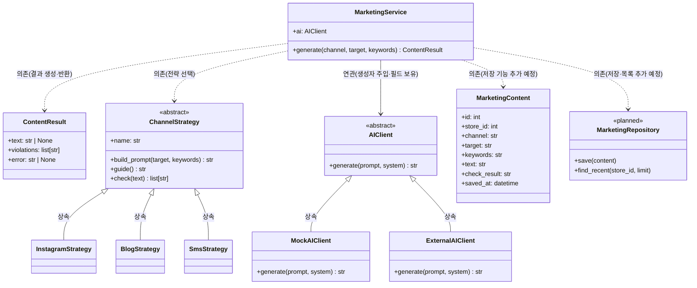
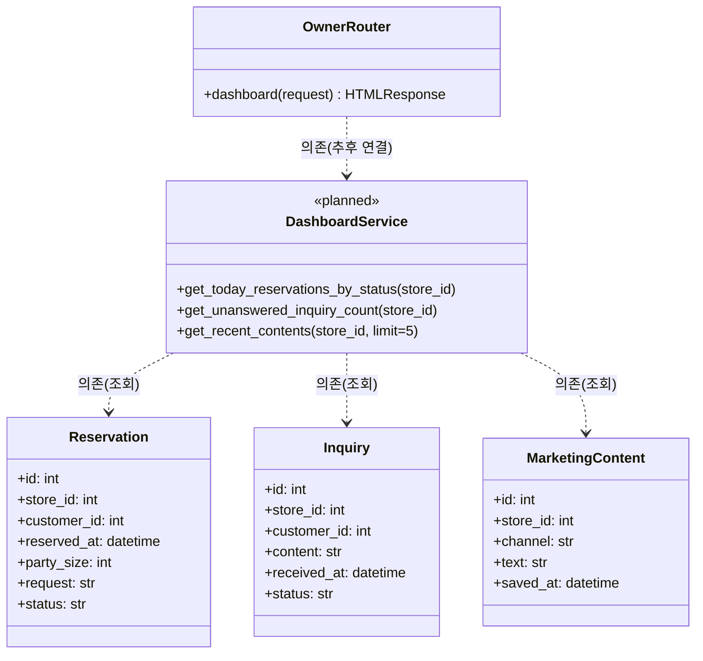

# 클래스 다이어그램 (초안 · 저장소 코드 대조본)

> 아래 다이어그램은 `main` 브랜치에서 확인한 실제 클래스와 아직 구현이 필요한 설계 요소를 구분한다. `<<planned>>` 표시는 현재 코드에서 구현을 확인하지 못한 항목이다.

## 1. F-04 홍보 문구 생성 중심 클래스

## 2. F-05 대시보드 중심 클래스

## 3. 관계 유형 구분

- **상속(Inheritance, `<|--`):** 하위 클래스가 상위 클래스의 규약을 이어받는다. 예: `InstagramStrategy`는 `ChannelStrategy`를 상속한다.
- **연관(Association, `-->`):** 한 객체가 다른 객체를 멤버로 보유하거나 지속적으로 참조한다. 예: `MarketingService`는 생성자로 받은 `AIClient`를 `self.ai`에 보관한다.
- **의존(Dependency, `..>`):** 메서드 안에서 다른 클래스나 기능을 일시적으로 사용한다. 예: `MarketingService`는 `get_strategy()`로 전략을 선택한다.
- 현재 확인된 코드에서는 위 세 관계를 표시했다. **합성(Composition) 관계는 생명주기를 소유하는 근거가 확인되지 않아 억지로 표시하지 않았다.**
- `DashboardService`, `MarketingRepository`는 `<<planned>>`로 표시한 설계 예정 요소이며 현재 구현된 클래스가 아니다.

## 4. 다이어그램 해설

- `MarketingService`, `ContentResult`, `ChannelStrategy`, `InstagramStrategy`, `BlogStrategy`, `SmsStrategy`는 `app/services/marketing/`에서 확인했다.
- `AIClient`는 `app/adapters/ai/base.py`의 추상 클래스다. `MockAIClient`, `ExternalAIClient`가 이를 구현하고 `factory.get_ai_client()`가 설정에 따라 선택한다.
- `MarketingContent`는 `app/models/models.py`에 실제 SQLAlchemy 모델로 정의되어 있다. 다만 현재 `MarketingService`에는 DB 저장·목록 조회가 구현되어 있지 않다.
- `OwnerRouter`는 `app/presentation/routers/owner.py`의 `/owner` 라우트다. 현재 빈 데이터를 템플릿에 전달한다. `DashboardService`는 설계상 필요한 예정 클래스이며 아직 구현을 확인하지 못했다.
- 대시보드의 `Reservation`, `Inquiry`, `MarketingContent`는 실제 모델이다.

## 5. 추가 구현 예정 사항

1. F-04에 저장·목록 조회 기능을 추가하고 저장소 계층과 연결한다.
2. 홍보 문구의 메뉴명·가격 대조 로직을 추가한다. 현재 `FactChecker`는 문의 서비스에서 사용하며, 홍보 서비스에는 아직 연결되지 않았다.
3. F-05의 `DashboardService`를 구현해 오늘 예약, 미응답 문의 수, 최근 콘텐츠 5건을 조회한다.
4. 구현 완료 후 메서드 시그니처와 관계를 코드에 맞춰 다시 갱신한다.
