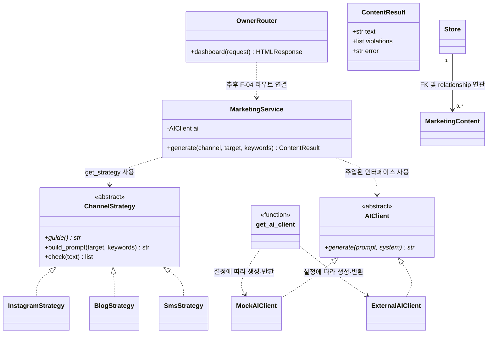
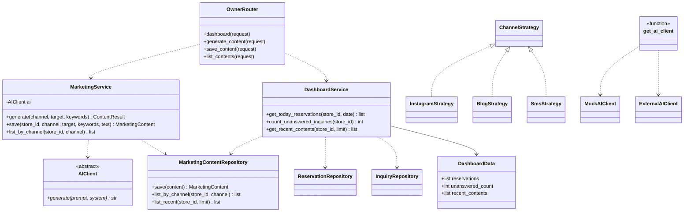

# 클래스 다이어그램 및 SOLID 점검

- 프로젝트: 소상공인용 AI 마케팅·고객응대 통합 지원 시스템
- 작성자: 전지호
- 작성 기간: 2026. 11. 3. ~ 11. 8.
- 범위: F-04 홍보 문구, F-05 대시보드 및 공통 계층
- 기준 저장소: `sakakinji-maker/sw_make`의 `main` 브랜치 확인본

## 1. 설계 기준

- 프레젠테이션 계층은 서비스 계층을 호출한다.
- 서비스 계층은 라우터나 템플릿을 import하지 않는다.
- AI 호출은 `AIClient` 추상 클래스에 의존한다.
- 채널별 생성 규칙은 Strategy 패턴으로 분리한다.
- 데이터 모델은 SQLAlchemy 엔티티로 표현한다.
- **현재 구현된 클래스**와 **추후 구현할 설계 대상**을 구분한다.

## 2. 현재 코드 기준 클래스 다이어그램

아래는 저장소에서 확인한 클래스와 호출 관계다. 아직 구현되지 않은 Repository 및 DashboardService는 이 그림에 현재 구현체로 넣지 않았다.

**주의:** `OwnerRouter`의 현재 `dashboard()`는 빈 목록을 템플릿에 전달하는 기본 화면 라우트다. 현재 `owner.py`에는 홍보 문구 생성·저장·목록 라우트가 없다. `MarketingService`는 생성과 규칙 검사만 수행하며 DB 저장·목록 조회는 TODO다. `ExternalAIClient.generate()`도 아직 실제 API 호출이 아니라 미구현 오류를 반환한다.

## 3. 목표 설계 클래스 다이어그램 (F-04/F-05 구현 시)

다음 그림은 현재 구현 상태가 아니라 후속 구현을 위한 목표 구조다.

## 4. 주요 클래스 책임 및 실제 구현 상태

| 클래스/구성요소 | 책임 | 저장소 확인 상태 |
|---|---|---|
| `MarketingService` | 채널 전략 선택, AI 문구 생성, 규칙 검사 | 생성 기능 구현. 저장·목록은 TODO |
| `ContentResult` | 생성 문구, 규칙 위반, 오류 결과 전달 | 구현 |
| `ChannelStrategy` | 채널별 프롬프트와 규칙 검사 계약 | 구현 |
| `InstagramStrategy` | 인스타그램 규칙 | 구현 |
| `BlogStrategy` | 블로그 규칙 | 구현 |
| `SmsStrategy` | 문자 규칙 | 구현 |
| `AIClient` | AI 생성 호출 추상화 | 구현 |
| `MockAIClient` | 테스트용 응답 또는 오류 반환 | 구현 |
| `ExternalAIClient` | 외부 AI 연동 | 클래스는 있으나 실제 `generate()`는 미구현 |
| `OwnerRouter.dashboard` | 점주 대시보드 기본 화면 반환 | 빈 데이터 전달 상태. 실제 조회 TODO |
| `MarketingContent` 등 모델 | DB 엔티티 | `app/models/models.py`에 구현 |
| `MarketingContentRepository` | 홍보 콘텐츠 저장·조회 | 저장소에 별도 구현 확인되지 않음. 설계 대상 |
| `DashboardService` | 대시보드 데이터 집계 | 저장소에 구현 확인되지 않음. 설계 대상 |
| `DashboardData` | 대시보드 전달 데이터 구조 | 저장소에 구현 확인되지 않음. 설계 대상 |

## 5. AI Adapter 관계 설명

- `AIClient`는 `app/adapters/ai/base.py`의 추상 클래스다.
- `MockAIClient`와 `ExternalAIClient`가 이를 상속한다.
- `get_ai_client()`는 `factory.py`에 정의된 **함수**이며 `AI_PROVIDER` 설정에 따라 구체 Adapter를 생성해 반환한다. 별도의 `AIFactory` 클래스는 존재하지 않는다.
- `MarketingService`는 생성자에서 `AIClient` 구현 객체를 주입받아 사용한다. `MarketingService.generate()` 내부에서 Factory를 직접 호출하지 않는다.
- 실행 흐름은 호출 측에서 Factory 함수로 구현 객체를 얻어 서비스 생성자에 전달하고, 서비스가 `self.ai.generate()`로 호출하는 구조다. 현재 저장소에서 서비스 생성·주입 지점 전체가 확인된 것은 아니므로, 다이어그램은 클래스 간 계약과 의존 관계를 나타낸다.
- 현재 외부 Adapter는 실제 API 요청을 수행하지 않는다. `generate()` 호출 시 미구현 오류를 반환한다.

## 6. UML 관계 유형 구분

운영계획서의 클래스 설계 최소 요건에 따라 관계를 구분했다. 코드에서 확인되지 않는 생명주기 관계는 구현 사실처럼 표시하지 않는다.

| 관계 유형 | UML 표기 | 이 설계에서의 적용 | 근거 및 주의사항 |
|---|---|---|---|
| 상속(일반화) | 실선 + 빈 삼각형 | 공통 부모 클래스를 상속하는 경우 | 현재 채널·AI 클래스는 ABC 추상 클래스를 구현하므로 아래 실체화 관계로 표현 |
| 실체화 | 점선 + 빈 삼각형 | `InstagramStrategy`, `BlogStrategy`, `SmsStrategy` → `ChannelStrategy`; `MockAIClient`, `ExternalAIClient` → `AIClient` | 각 추상 클래스의 계약을 구체 클래스가 구현 |
| 연관 | 실선 | `Store` — `MarketingContent` | SQLAlchemy FK와 양방향 `relationship(back_populates=...)`로 확인 |
| 집합 | 빈 마름모 | 목표 도메인에서 매장과 매장 소속 콘텐츠의 전체-부분 개념 | 설계상 소속 관계를 표현할 때만 사용. 현재 ORM 관계만으로 집합의 생명주기 의미가 강제되는 것은 아님 |
| 구성 | 채운 마름모 | 현재 코드에서 확정 표기하지 않음 | `Reservation.histories` 관계는 있지만 `delete-orphan` 등 종속 생명주기 설정이 없어 구성이라고 단정할 근거가 부족함. 향후 예약 삭제 시 이력도 반드시 삭제할 정책을 채택하면 cascade 정책을 명시하고 구성으로 모델링 가능 |
| 의존 | 점선 화살표 | `MarketingService` → `AIClient`, `MarketingService` → `ChannelStrategy`; `get_ai_client()` 함수 → 구체 Adapter | 메서드 호출·타입 주입·생성 관계에 따른 사용 의존. Factory는 클래스가 아닌 함수 |

현재 클래스 다이어그램에서는 ABC 계약 구현을 실체화(`..|>`)로, 서비스의 사용 관계를 의존(`..>`)으로, DB 모델 관계를 연관(`-->`)으로 표시했다. 집합·구성은 실제 생명주기 정책이 확인되지 않는 부분을 과장하지 않도록 표의 개념/조건부 설명으로 분리했다. 운영계획서의 관계 유형 구분 요건을 충족하기 위해, 실제 코드에 없는 구성 관계를 사실처럼 그리지 않고 미확정 사유를 명시했다.

## 7. SOLID 점검

아래는 설계 기준과 코드에서 확인한 근거다. 실행 테스트를 수행하지 않은 항목을 통과로 표시하지 않는다.

| 원칙 | 적용/근거 | 현재 판단 |
|---|---|---|
| SRP 단일 책임 | 채널 규칙은 `strategies.py`, 생성 흐름은 `MarketingService`, HTTP 처리는 Router, 모델은 SQLAlchemy 엔티티로 분리 | 구조상 분리 확인. 저장·대시보드 계층은 미완성 |
| OCP 개방-폐쇄 | `@register`와 `ChannelStrategy` 하위 클래스로 채널 등록 | 새 전략 추가 구조 확인. 확장 테스트는 별도 실행 필요 |
| LSP 리스코프 치환 | 채널 전략이 `guide()`를 구현하고 공통 `build_prompt()`·`check()` 사용 | 계약 구조 확인. 모든 전략 대체 테스트 결과는 미확인 |
| ISP 인터페이스 분리 | AI 기능은 `AIClient.generate()` 한 메서드 계약 사용 | 인터페이스 구조 확인 |
| DIP 의존 역전 | `MarketingService`가 `AIClient` 추상 클래스에 의존하고 Factory가 구현체 선택 | 코드 구조 확인. Mock/External 교체 테스트 결과는 미확인 |

### 7.1 SOLID 위반 의심 지점 및 개선안 (최소 1건)

**의심 지점: SRP(단일 책임 원칙) — `app/services/marketing/strategies.py`의 변경 이유 집중**

현재 파일 하나에 다음 역할이 함께 들어 있다.

1. 채널 전략의 추상 계약(`ChannelStrategy`)
2. 전략 등록·검색을 담당하는 전역 레지스트리(`_REGISTRY`, `register()`, `get_strategy()`)
3. 인스타그램·블로그·문자별 구체 정책 클래스

채널 정책 변경, 전략 등록 방식 변경, 추상 계약 변경은 서로 다른 이유로 발생할 수 있으므로 한 파일에 함께 있으면 변경 영향 범위가 커질 수 있다. 이는 현재 코드에서 확인되는 **SRP 위반 가능성**이지, 실행 테스트로 확정한 결함은 아니다.

**개선안:** 책임을 다음처럼 분리한다. 기존 외부 호출 계약은 유지해 점진적으로 옮긴다.

- `strategies/base.py`: `ChannelStrategy` 추상 계약
- `strategies/registry.py`: `register()`, `get_strategy()`, 레지스트리 관리
- `strategies/channels/instagram.py`, `blog.py`, `sms.py`: 채널별 정책 클래스
- `strategies/channels/__init__.py`: 구체 전략 등록

**개선 효과:** 채널 정책 수정이 등록 로직이나 공통 추상 계약에 불필요한 영향을 주지 않으며, 각 책임을 독립적으로 테스트하기 쉬워진다. 단, 현재 프로젝트 규모에서는 파일 분리가 오히려 복잡도를 높일 수 있으므로 채널 수가 늘어날 때 적용하는 것이 적절하다.

## 8. 설계 검증 체크리스트

- [ ] 채널 3종이 동일한 `ChannelStrategy` 계약으로 동작하는지 테스트
- [ ] 지원하지 않는 채널 요청 시 명확한 오류가 반환되는지 테스트
- [ ] 글자 수·해시태그 수의 정상/경계/초과 케이스 테스트
- [ ] AI 호출 실패 시 오류 결과 반환 테스트
- [ ] 홍보 콘텐츠 저장 및 채널별 조회 구현·테스트
- [ ] 대시보드가 오늘 예약, 미응답 문의 수, 최근 콘텐츠 5건을 표시하는지 테스트
- [ ] 서비스 계층에서 SQL 또는 템플릿 처리를 직접 하지 않는지 확인
- [ ] Mock Adapter로 교체해도 생성 테스트가 통과하는지 확인

**점검 결과 기록 원칙:** 테스트를 실제 실행한 뒤 실행 명령, 통과/실패 건수, 확인 날짜를 이 절에 추가한다. 실행 전에는 체크하지 않는다.
