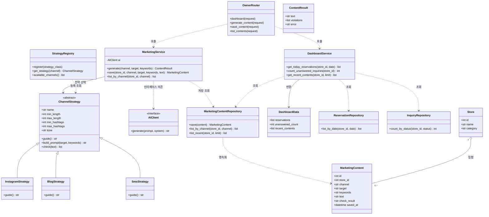

# 클래스 다이어그램 및 SOLID 점검

- 프로젝트: 소상공인용 AI 마케팅·고객응대 통합 지원 시스템
- 작성자: 전지호
- 작성 기간: 2026. 11. 3. ~ 11. 8.
- 범위: F-04 홍보 문구, F-05 대시보드 및 공통 계층

## 1. 설계 기준

- 프레젠테이션 계층은 서비스 계층만 호출한다.
- 서비스 계층은 라우터나 템플릿을 import하지 않는다.
- AI 호출은 `AIClient` 인터페이스를 통해서만 수행한다.
- 채널별 생성 규칙은 Strategy 패턴으로 분리한다.
- 데이터 모델은 SQLAlchemy 엔티티로 표현하고 데이터 접근은 Repository 경계로 분리한다.
- 현재 저장소에 구현된 클래스와 이후 구현할 설계 클래스를 구분한다.

## 2. 클래스 다이어그램

**표기 설명**

- 실선 화살표: 참조·연관 또는 호출 방향.
- 점선 화살표: 의존.
- 빈 삼각형: 상속.
- 빈 마름모: 집합(전체 객체와 부분 객체의 생명주기가 독립).
- `AIClient`는 인터페이스이며 실제 구현체(Mock 또는 외부 API Adapter)는 런타임 설정에 따라 연결한다.

## 3. 주요 클래스 책임 및 구현 상태

| 클래스 | 책임 | 저장소 기준 상태 |
|---|---|---|
| `MarketingService` | 채널 전략 선택, AI 문구 생성, 규칙 검사 결과 반환 | 기본 생성 로직 구현, 저장·목록 TODO |
| `ChannelStrategy` | 채널별 프롬프트 가이드와 규칙 검사 정의 | 구현 |
| `InstagramStrategy` | 인스타그램 글자 수·해시태그·어조 규칙 | 구현 |
| `BlogStrategy` | 블로그 글자 수·해시태그·어조 규칙 | 구현 |
| `SmsStrategy` | 문자 길이·해시태그 제한 | 구현 |
| `AIClient` | AI 제공사 호출 인터페이스 | 구현 |
| `MarketingContentRepository` | 홍보 콘텐츠 저장 및 채널별·최근 목록 조회 | 설계 대상 |
| `DashboardService` | 오늘 예약, 미응답 문의 수, 최근 콘텐츠 조회 조합 | 설계 대상 |
| `DashboardData` | 대시보드 템플릿에 전달할 조회 결과 | 설계 대상 |
| `OwnerRouter` | 점주 요청을 서비스에 전달하고 결과 화면 반환 | 대시보드 기본 라우트 구현, F-04 라우트 TODO |

설계 대상 클래스는 이후 구현 단계에서 추가한다. 현재 코드에 이미 있는 것처럼 표현하지 않는다.

## 4. 관계 유형 구분

| 관계 유형 | 적용 사례 | 설명 |
|---|---|---|
| 상속 | InstagramStrategy, BlogStrategy, SmsStrategy → ChannelStrategy | 공통 규칙 검사와 프롬프트 구성은 부모가 제공하고 채널별 가이드는 하위 클래스가 구현 |
| 연관 | OwnerRouter → MarketingService | 라우터가 서비스 객체를 사용 |
| 의존 | MarketingService → AIClient | 생성 요청 시 인터페이스에 의존 |
| 의존 | DashboardService → 각 Repository | 필요한 조회를 요청 |
| 집합 | Store ◇— MarketingContent | 매장에 콘텐츠가 여러 건 연결되며 콘텐츠 레코드는 독립 식별자를 가짐 |
| 실체화 | Mock/External Adapter → AIClient | 실제 Adapter가 인터페이스의 동작을 구현 |
| 구성 | 이번 F-04/F-05 범위에서 별도 구성 관계를 두지 않음 | 생명주기가 강하게 종속되는 객체를 불필요하게 만들지 않음 |

## 5. SOLID 점검

| 원칙 | 적용 내용 | 점검 기준 |
|---|---|---|
| SRP 단일 책임 | 채널 전략은 채널별 규칙, MarketingService는 생성 흐름, Repository는 데이터 접근, Router는 HTTP 처리 담당 | 채널 규칙 변경으로 Router나 Repository를 수정하지 않는지 확인 |
| OCP 개방-폐쇄 | 새 홍보 채널은 `ChannelStrategy` 구현 클래스와 등록으로 추가 | 기존 전략 클래스 수정 없이 새 채널을 등록할 수 있는지 테스트 |
| LSP 리스코프 치환 | 각 채널 전략은 공통 `build_prompt()`와 `check()` 계약을 지킴 | 어떤 전략을 전달해도 MarketingService의 생성 흐름이 동일하게 동작하는지 확인 |
| ISP 인터페이스 분리 | 서비스가 필요한 AI 생성 기능만 `AIClient` 인터페이스로 사용 | 서비스가 특정 공급자 전용 메서드에 의존하지 않는지 확인 |
| DIP 의존 역전 | MarketingService는 구체 AI SDK가 아닌 `AIClient` 추상화에 의존 | Mock Adapter와 외부 Adapter를 교체해도 서비스 코드 변경이 없는지 확인 |

## 6. 설계 검증 항목

- [ ] 채널 3종이 동일한 `ChannelStrategy` 계약으로 동작한다.
- [ ] 지원하지 않는 채널을 요청하면 명확한 오류가 반환된다.
- [ ] 글자 수와 해시태그 수의 정상·경계·초과 케이스를 테스트한다.
- [ ] AI 호출 실패 시 오류 결과가 반환되고 화면이 중단되지 않는다.
- [ ] 저장된 콘텐츠는 채널별로 조회할 수 있다.
- [ ] 대시보드는 오늘 예약, 미응답 문의 수, 최근 콘텐츠 5건만 요구사항대로 표시한다.
- [ ] 서비스 계층에서 SQL이나 템플릿 처리를 직접 하지 않는다.
- [ ] Mock Adapter로 교체해도 홍보 문구 생성 테스트가 통과한다.
