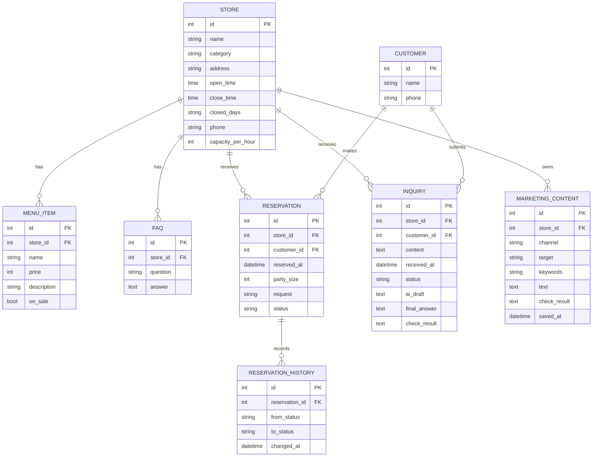

# 데이터베이스 ERD (초안 · 실제 모델 코드 대조본)

> 기준 파일: `app/models/models.py`. 아래 엔티티와 속성은 현재 SQLAlchemy 모델에 선언된 항목을 기준으로 정리했다. 실제 DB 마이그레이션·제약 조건은 구현 변경에 따라 달라질 수 있다.

## 1. ERD

## 2. 엔티티 및 속성

| 엔티티(테이블) | 실제 코드의 속성 |
|---|---|
| Store (`stores`) | `id`, `name`, `category`, `address`, `open_time`, `close_time`, `closed_days`, `phone`, `capacity_per_hour` |
| MenuItem (`menu_items`) | `id`, `store_id`, `name`, `price`, `description`, `on_sale` |
| FAQ (`faqs`) | `id`, `store_id`, `question`, `answer` |
| Customer (`customers`) | `id`, `name`, `phone` |
| Reservation (`reservations`) | `id`, `store_id`, `customer_id`, `reserved_at`, `party_size`, `request`, `status` |
| ReservationHistory (`reservation_histories`) | `id`, `reservation_id`, `from_status`, `to_status`, `changed_at` |
| Inquiry (`inquiries`) | `id`, `store_id`, `customer_id`, `content`, `received_at`, `status`, `ai_draft`, `final_answer`, `check_result` |
| MarketingContent (`marketing_contents`) | `id`, `store_id`, `channel`, `target`, `keywords`, `text`, `check_result`, `saved_at` |

## 3. 관계

- Store 1개는 MenuItem, FAQ, Reservation, Inquiry, MarketingContent를 여러 개 가질 수 있다.
- Customer 1명은 Reservation과 Inquiry를 여러 개 등록할 수 있다.
- Reservation 1건은 ReservationHistory를 여러 건 가질 수 있다.
- 현재 모델 코드에서 확인한 외래키는 `MenuItem.store_id`, `FAQ.store_id`, `Reservation.store_id`, `Reservation.customer_id`, `ReservationHistory.reservation_id`, `Inquiry.store_id`, `Inquiry.customer_id`, `MarketingContent.store_id`다.

## 4. 확인이 필요한 사항

- `Customer`와 `Store` 사이에는 직접 외래키가 없다. 고객이 여러 매장을 이용하는 구조인지, 단일 매장 전용인지 요구사항과 팀에서 확인한다.
- 전화번호·메뉴명 등의 고유 제약, 삭제 시 연쇄 처리, 인덱스 정책은 현재 모델 코드에서 별도로 선언된 것을 확인하지 못했다.
- `status`, `channel`은 현재 문자열 컬럼이다. 허용 값은 서비스 규칙과 요구사항에 맞춰 관리한다.
- ERD는 코드 대조 초안이며, DB 생성 결과와 팀 합의 후 최종 확정한다.
