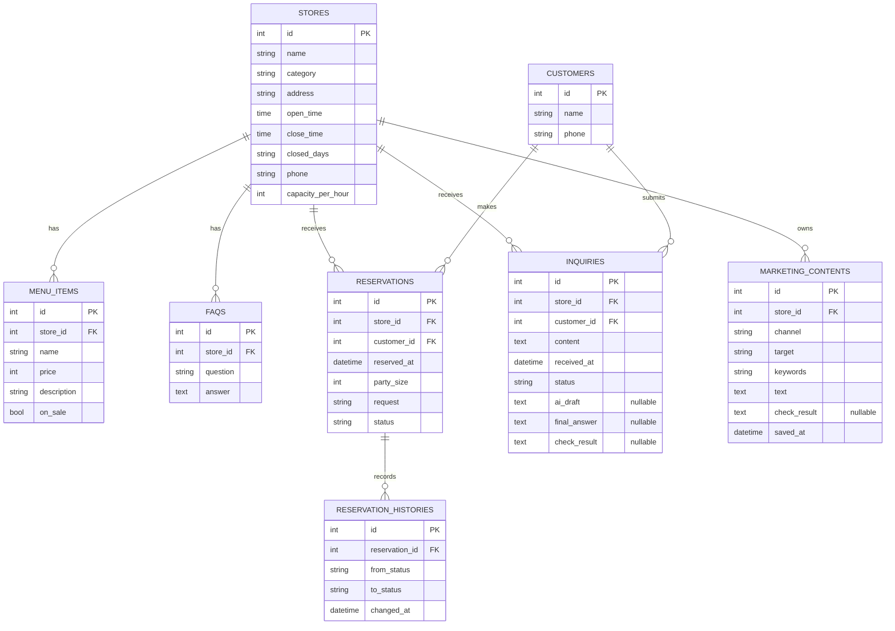

# 데이터베이스 설계서 (ERD)

- 프로젝트: 소상공인용 AI 마케팅·고객응대 통합 지원 시스템
- 작성자: 전지호
- 작성 기간: 2026. 11. 3. ~ 11. 8.
- 기준 코드: `app/models/models.py` (`sakakinji-maker/sw_make`, `main` 브랜치 확인본)

## 1. 설계 범위 및 기준

아래 ERD는 저장소의 SQLAlchemy 모델을 기준으로 정리했다. 기존 엔티티 8개를 사용하며, F-04와 F-05를 위해 별도 대시보드 테이블은 만들지 않는다.

- F-04 관련: `stores`, `marketing_contents`
- F-05 관련: `stores`, `reservations`, `inquiries`, `marketing_contents`
- 전체 엔티티: `stores`, `menu_items`, `faqs`, `customers`, `reservations`, `reservation_histories`, `inquiries`, `marketing_contents`

## 2. ERD

## 3. 테이블 정의 (코드 기준)

자료형은 SQLAlchemy의 Python 타입 및 명시된 `String`/`Text` 길이를 기준으로 표기했다. `nullable`은 모델의 타입 선언을 기준으로 구분했다. Python 측 `default`는 DB 서버 기본값과 동일한 의미가 아니다.

### 3.1 stores (매장)

| 컬럼 | 자료형 | NULL | 기본값/제약 | 설명 |
|---|---|---|---|---|
| id | INTEGER | 불가 | PK | 매장 식별자 |
| name | VARCHAR(100) | 불가 | | 매장명 |
| category | VARCHAR(50) | 불가 | | 업종 |
| address | VARCHAR(200) | 불가 | | 주소 |
| open_time | TIME | 불가 | | 영업 시작 시각 |
| close_time | TIME | 불가 | | 영업 종료 시각 |
| closed_days | VARCHAR(50) | 불가 | Python default `""` | 휴무일 |
| phone | VARCHAR(30) | 불가 | | 매장 연락처 |
| capacity_per_hour | INTEGER | 불가 | Python default `10` | 시간당 예약 정원 |

### 3.2 menu_items (메뉴·상품)

| 컬럼 | 자료형 | NULL | 기본값/제약 | 설명 |
|---|---|---|---|---|
| id | INTEGER | 불가 | PK | 메뉴 식별자 |
| store_id | INTEGER | 불가 | FK → stores.id | 소속 매장 |
| name | VARCHAR(100) | 불가 | | 메뉴명 |
| price | INTEGER | 불가 | | 가격(원) |
| description | VARCHAR(300) | 불가 | Python default `""` | 설명 |
| on_sale | BOOLEAN | 불가 | Python default `True` | 판매 여부 |

### 3.3 faqs (자주 묻는 질문)

| 컬럼 | 자료형 | NULL | 기본값/제약 | 설명 |
|---|---|---|---|---|
| id | INTEGER | 불가 | PK | FAQ 식별자 |
| store_id | INTEGER | 불가 | FK → stores.id | 소속 매장 |
| question | VARCHAR(300) | 불가 | | 질문 |
| answer | TEXT | 불가 | | 답변 |

### 3.4 customers (고객)

| 컬럼 | 자료형 | NULL | 기본값/제약 | 설명 |
|---|---|---|---|---|
| id | INTEGER | 불가 | PK | 고객 식별자 |
| name | VARCHAR(50) | 불가 | | 고객명 |
| phone | VARCHAR(30) | 불가 | | 연락처 |

### 3.5 reservations (예약)

| 컬럼 | 자료형 | NULL | 기본값/제약 | 설명 |
|---|---|---|---|---|
| id | INTEGER | 불가 | PK | 예약 식별자 |
| store_id | INTEGER | 불가 | FK → stores.id | 예약 대상 매장 |
| customer_id | INTEGER | 불가 | FK → customers.id | 예약 고객 |
| reserved_at | DATETIME | 불가 | | 예약 일시 |
| party_size | INTEGER | 불가 | | 예약 인원 |
| request | VARCHAR(300) | 불가 | Python default `""` | 요청사항 |
| status | VARCHAR(10) | 불가 | Python default `"요청"` | 예약 상태 |

### 3.6 reservation_histories (예약 상태 이력)

| 컬럼 | 자료형 | NULL | 기본값/제약 | 설명 |
|---|---|---|---|---|
| id | INTEGER | 불가 | PK | 이력 식별자 |
| reservation_id | INTEGER | 불가 | FK → reservations.id | 대상 예약 |
| from_status | VARCHAR(10) | 불가 | | 변경 전 상태 |
| to_status | VARCHAR(10) | 불가 | | 변경 후 상태 |
| changed_at | DATETIME | 불가 | Python default `datetime.now` | 변경 시각 |

### 3.7 inquiries (고객 문의)

| 컬럼 | 자료형 | NULL | 기본값/제약 | 설명 |
|---|---|---|---|---|
| id | INTEGER | 불가 | PK | 문의 식별자 |
| store_id | INTEGER | 불가 | FK → stores.id | 문의 대상 매장 |
| customer_id | INTEGER | 불가 | FK → customers.id | 문의 고객 |
| content | TEXT | 불가 | | 문의 내용 |
| received_at | DATETIME | 불가 | Python default `datetime.now` | 접수 시각 |
| status | VARCHAR(10) | 불가 | Python default `"미응답"` | 처리 상태 |
| ai_draft | TEXT | 가능 | Python default `None` | AI 원본 초안 |
| final_answer | TEXT | 가능 | Python default `None` | 점주 확정 답변 |
| check_result | TEXT | 가능 | Python default `None` | DB 대조 결과(JSON) |

### 3.8 marketing_contents (홍보 콘텐츠)

| 컬럼 | 자료형 | NULL | 기본값/제약 | 설명 |
|---|---|---|---|---|
| id | INTEGER | 불가 | PK | 콘텐츠 식별자 |
| store_id | INTEGER | 불가 | FK → stores.id | 소속 매장 |
| channel | VARCHAR(20) | 불가 | | instagram·blog·sms |
| target | VARCHAR(100) | 불가 | | 홍보 대상 |
| keywords | VARCHAR(200) | 불가 | Python default `""` | 생성 키워드 |
| text | TEXT | 불가 | | 저장된 홍보 문구 |
| check_result | TEXT | 가능 | Python default `None` | 채널 규칙 검사 결과 |
| saved_at | DATETIME | 불가 | Python default `datetime.now` | 저장 시각 |

## 4. 관계 및 카디널리티

| 부모 | 자식 | 관계 | 코드 근거 |
|---|---|---|---|
| stores | menu_items | 1:N | `MenuItem.store_id` FK, `Store.menu_items` |
| stores | faqs | 1:N | `FAQ.store_id` FK, `Store.faqs` |
| stores | reservations | 1:N | `Reservation.store_id` FK, `Store.reservations` |
| stores | inquiries | 1:N | `Inquiry.store_id` FK, `Store.inquiries` |
| stores | marketing_contents | 1:N | `MarketingContent.store_id` FK, `Store.contents` |
| customers | reservations | 1:N | `Reservation.customer_id` FK, `Reservation.customer` |
| customers | inquiries | 1:N | `Inquiry.customer_id` FK, `Inquiry.customer` |
| reservations | reservation_histories | 1:N | `ReservationHistory.reservation_id` FK, `Reservation.histories` |

## 5. F-04·F-05 데이터 처리 기준

### F-04 홍보 문구

1. 점주가 채널·홍보 대상·키워드를 선택한다.
2. `MarketingService`가 채널 전략으로 프롬프트를 구성하고 AI 생성 결과를 받는다.
3. 채널 전략이 글자 수와 해시태그 수를 검사한다.
4. 점주가 결과를 확인·수정한 뒤 저장한다.
5. 최종 저장 내용은 `marketing_contents`에 기록하도록 설계한다.
6. **현재 코드 상태:** `MarketingContent` 모델은 있으나 `MarketingService`의 저장·목록 조회는 TODO이며 Repository 구현도 확인되지 않았다.

### F-05 대시보드

- 오늘 예약: `reservations.reserved_at` 날짜와 `store_id` 조건으로 조회하고 상태를 함께 표시한다.
- 미응답 문의 수: `inquiries.store_id`와 `status = '미응답'` 조건으로 집계한다.
- 최근 콘텐츠: `marketing_contents.store_id` 조건으로 `saved_at` 내림차순 정렬 후 5건을 조회한다.
- 대시보드 전용 테이블은 만들지 않고 기존 테이블을 조회한다.
- **현재 코드 상태:** `/owner` 라우트는 존재하지만 빈 예약 목록, 미응답 수 0, 빈 콘텐츠 목록을 전달한다. 위 집계 조회는 아직 구현된 것으로 확인되지 않았다.

## 6. 데이터 무결성 및 운영 기준

- 각 테이블의 기본키는 `id`로 식별한다.
- 외래키는 실제 부모 레코드를 참조하도록 모델에 선언되어 있다.
- 매장 데이터는 업무 데이터의 기준이며 `store_id`로 매장 범위를 구분한다.
- 예약 상태 변경 이력은 별도 `reservation_histories` 행으로 기록하는 서비스 로직이 존재한다.
- AI 원본 초안과 점주 최종 답변을 분리해 저장할 수 있도록 `ai_draft`, `final_answer` 컬럼을 둔다.
- 실제 개인정보 대신 프로젝트에서 생성한 가상 데이터를 사용한다.
- 현재 DB 연결 설정은 `DATABASE_URL` 환경설정에 따르며 프로젝트 기본 DB는 SQLite로 설계되어 있다.

## 7. 코드 대조 시 확인할 사항

- [x] 모델 파일에 정의된 엔티티 8개 반영
- [x] 각 외래키와 SQLAlchemy relationship 반영
- [x] `inquiries`의 nullable 필드 3개 반영
- [x] `marketing_contents.check_result` nullable 반영
- [ ] 실제 생성된 SQLite 스키마와 컬럼·제약조건 최종 대조
- [ ] 마이그레이션 또는 스키마 변경 이력 확인

체크된 항목은 코드 정의를 확인했다는 뜻이며, 실제 DB 파일을 열어 검증했다는 뜻은 아니다.
