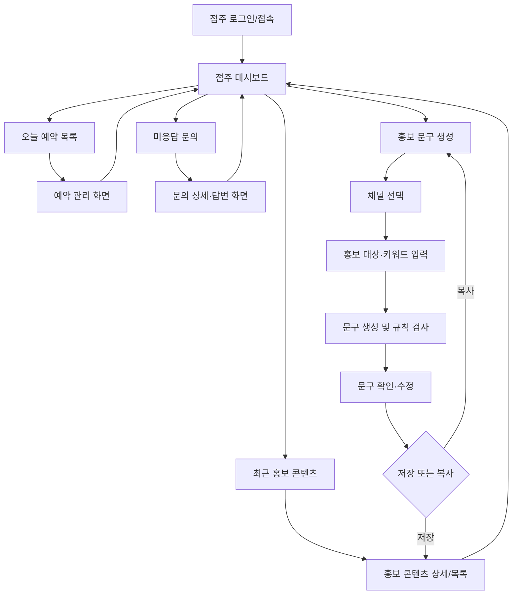
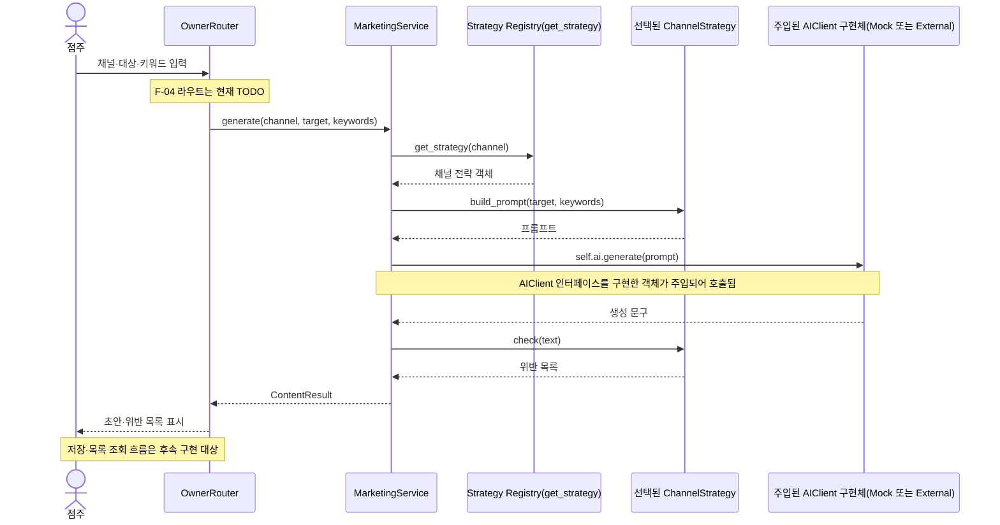
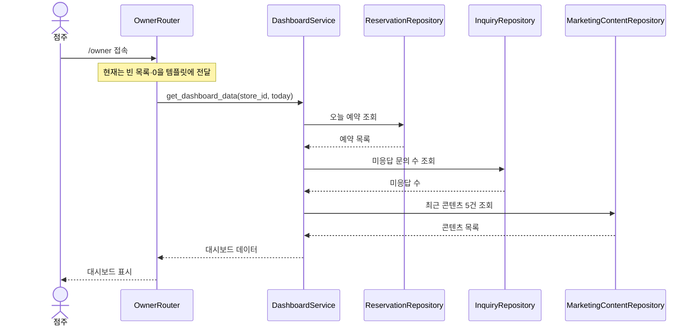

# 시스템 설계서

- 프로젝트: 소상공인용 AI 마케팅·고객응대 통합 지원 시스템
- 팀: 신창섭
- 작성자: 전지호(설계)
- 작성 기간: 2026. 11. 3. ~ 11. 8.
- 관련 기능: F-04 홍보 문구 생성, F-05 점주 대시보드
- 기준 저장소: `sakakinji-maker/sw_make`의 `main` 브랜치 확인본

## 1. 설계 범위

이번 문서는 WBS에서 전지호에게 배정된 설계 산출물이다. 시스템 전체 구조를 정의하되 담당 기능인 F-04와 F-05를 중심으로 상세 설계한다.

- F-04-1: 점주는 인스타그램·블로그·문자 채널, 홍보 대상, 키워드를 선택해 문구를 생성한다.
- F-04-2: 채널별 글자 수·해시태그 수·어조 규칙을 적용하고 위반 여부를 표시한다.
- F-04-3: 생성 문구를 수정·저장·복사하고 채널별 저장 목록을 조회한다.
- F-05-1: 오늘 예약 목록(상태별), 미응답 문의 수, 최근 생성 콘텐츠 5건을 표시한다.
- F-05-2: 대시보드 항목 선택 시 해당 처리 화면으로 이동한다.

이번 주 산출물은 설계 문서다. 저장소 코드에서 확인한 현재 구현과 향후 구현할 목표 설계를 구분한다.

## 2. 아키텍처 스타일

### 2.1 선택한 구조: 3계층 아키텍처 + 클라이언트-서버 구조

1. **프레젠테이션 계층**: FastAPI 라우터와 Jinja2 템플릿으로 고객 화면과 점주 화면을 제공한다.
2. **서비스 계층**: 예약·문의·홍보 기능의 업무 규칙을 처리한다. 홍보 문구 생성은 `MarketingService`, 대시보드 데이터 구성은 후속 구현할 `DashboardService`가 담당하도록 설계한다.
3. **데이터 계층**: SQLAlchemy 모델과 향후 Repository 경계가 데이터 조회·저장을 담당한다.

브라우저는 FastAPI 서버에 요청한다. 서버는 서비스 및 데이터 계층을 거쳐 결과를 반환한다. AI 호출이 필요한 기능은 서비스가 주입받은 `AIClient` 구현 객체에 요청한다. `get_ai_client()` Factory 함수는 설정에 따라 구체 Adapter를 생성해 반환하며, 서비스가 Factory를 직접 호출하는 구조는 아니다.

### 2.2 선택 근거

- 업무 규칙을 화면과 분리하면 화면이 바뀌어도 서비스 로직을 재사용할 수 있다.
- 데이터 접근을 Repository로 분리하면 DB 조회 방식이 바뀌어도 화면과 업무 규칙의 수정 범위를 줄일 수 있다.
- 점주와 고객은 이용 목적이 다르므로 화면을 분리하되 서버와 DB는 공유한다.
- AI 제공사별 코드를 서비스에서 직접 호출하지 않고 Adapter 뒤에 두어 Mock과 외부 API를 교체할 수 있다.

### 2.3 현재 코드와 설계 목표의 구분

저장소에서 확인한 현재 상태는 다음과 같다.

- `app/main.py`에서 고객·점주 Router를 앱에 등록하고 시작 시 SQLAlchemy 테이블을 초기화한다.
- `app/presentation/routers/owner.py`에는 `/owner` 대시보드 라우트가 있으나 예약·문의·콘텐츠는 빈 값으로 전달한다.
- `MarketingService.generate()`는 채널 전략 선택, AI 생성, 규칙 검사까지 수행한다. 저장·목록 조회는 TODO다.
- `AIClient`, `MockAIClient`, `ExternalAIClient`, Factory는 존재한다. 다만 `ExternalAIClient.generate()`는 아직 실제 API를 호출하지 않는다.
- 모델은 `app/models/models.py`에 정의되어 있다. 별도 `app/repositories/` 구현은 확인되지 않았다.

따라서 Repository와 DashboardService는 현재 구현 완료 구성요소가 아니라 후속 설계 대상이다.

## 3. 시스템 구성도

```mermaid
flowchart TB
  subgraph Client[클라이언트]
    C[고객 브라우저]
    O[점주 브라우저]
  end
  subgraph Presentation[프레젠테이션 계층]
    CR[customer Router]
    OR[owner Router]
    CT[고객 템플릿]
    OT[점주 템플릿]
  end
  subgraph Service[서비스 계층]
    RS[ReservationService]
    IS[InquiryService]
    MS[MarketingService]
    DS[DashboardService\n후속 구현 대상]
  end
  subgraph Data[데이터 계층]
    Models[SQLAlchemy Models]
    Repo[Repository\n후속 구현 대상]
    DB[(SQLite)]
  end
  AI[AIClient 추상 클래스]
  Factory[get_ai_client()\nFactory 함수]
  Mock[MockAIClient]
  External[ExternalAIClient\n실 API 연동 미완성]
  C --> CR --> CT
  O --> OR --> OT
  CR --> RS
  CR --> IS
  OR -. F-04 연결 예정 .-> MS
  OR -. F-05 조회 연결 예정 .-> DS
  RS --> Models
  IS --> Models
  MS -. 저장·조회 구현 예정 .-> Repo
  DS -. 조회 구현 예정 .-> Repo
  Repo -.-> DB
  Models --> DB
  IS -. AIClient 구현 객체 사용 .-> AI
  MS -. AIClient 구현 객체 사용 .-> AI
  Factory -. 설정에 따라 생성·반환 .-> Mock
  Factory -. 설정에 따라 생성·반환 .-> External
  Mock -. AIClient 구현 .-> AI
  External -. AIClient 구현 .-> AI
```

점선으로 표시한 부분은 후속 구현 대상이다. 위 구성도는 목표 구조를 포함하며, 현재 모든 연결이 구현되어 있다는 뜻은 아니다.

## 4. 화면 흐름도

아래는 F-04/F-05 요구사항을 만족하기 위한 **제안 화면 흐름**이다. 저장소에서 실제 화면 이동 경로까지 확인된 상태는 아니므로 구현 완료 화면으로 간주하지 않는다.



## 5. 4+1 관점 설계

### 5.1 논리적 관점 (Logical View)

- 주요 도메인 객체: `Store`, `MenuItem`, `FAQ`, `Customer`, `Reservation`, `ReservationHistory`, `Inquiry`, `MarketingContent`.
- F-04는 `MarketingService`가 채널별 `ChannelStrategy`를 선택해 프롬프트와 규칙 검사를 수행한다.
- F-05는 목표 구조에서 `DashboardService`가 예약·문의·홍보 콘텐츠를 조회해 화면 표시용 결과로 구성한다.
- AI가 만든 결과는 자동 게시하지 않는다. 점주가 확인·수정한 뒤 저장·복사한다.

### 5.2 개발 관점 (Development View)

| 패키지 | 책임 | 관련 경로 및 상태 |
|---|---|---|
| presentation | HTTP 요청·응답 및 화면 | `app/presentation/routers/owner.py`, `customer.py`; 점주 대시보드는 기본 라우트 존재 |
| services/marketing | 채널 선택, 문구 생성, 규칙 검사 | `app/services/marketing/service.py`, `strategies.py`; 생성 기능 구현, 저장·목록 TODO |
| services/dashboard | 대시보드 조회 결과 구성 | 후속 구현 대상; 현재 경로 확인되지 않음 |
| repositories | 조회·저장 캡슐화 | 별도 구현 경로 확인되지 않음; 설계 대상 |
| models | DB 엔티티 | `app/models/models.py` 구현 |
| adapters/ai | AI 공급자 교체 | `app/adapters/ai/`; Mock 구현, External 실제 API 연동 미완성 |

### 5.3 프로세스 관점 (Process View)

#### F-04 홍보 문구 생성 시퀀스



#### F-05 대시보드 조회 시퀀스 (목표 설계)



F-04 시퀀스는 현재 구현된 `MarketingService` 내부 동작을 기준으로 작성하되 Router 연결 및 저장 단계는 TODO임을 표시했다. `AIClient`는 추상 인터페이스이며 런타임 호출 대상은 Factory가 선택해 주입한 구체 Adapter 객체다. F-05 시퀀스는 현재 구현이 아니라 목표 설계다.

**유스케이스 다이어그램 담당 구분:** 운영계획서 WBS상 유스케이스 다이어그램 완성은 한재형·정회성 담당이다. 전지호 담당 시스템 설계서에는 화면 흐름도와 핵심 기능 시퀀스를 포함하고, 유스케이스 산출물은 담당 팀원의 문서와 통합 검토한다.

### 5.4 물리적 관점 (Physical View)

- 실행 환경: Python 3.11 이상, FastAPI 서버, SQLite DB.
- 사용자 단말: 일반 웹 브라우저(고객·점주).
- 템플릿 렌더링은 서버에서 수행한다.
- AI 외부 API는 서버에서 Adapter를 통해 호출하도록 설계한다. API 키는 환경 변수로 관리하며 저장소에 커밋하지 않는다.
- 수업 프로젝트 시연은 가상 데이터와 Mock AI를 우선 사용한다.

### 5.5 시나리오 관점 (+1)

| 시나리오 | 요구사항 | 주요 구성요소 | 기대 결과 |
|---|---|---|---|
| 인스타그램 홍보 문구 생성 | F-04-1, F-04-2 | owner 라우터, MarketingService, InstagramStrategy, AIClient | 초안과 규칙 검사 결과 표시 |
| 문구 저장 및 목록 확인 | F-04-3 | MarketingService, MarketingContent 저장소 | 수정 문구 저장 및 채널별 조회 |
| 오늘 업무 현황 확인 | F-05-1 | owner 라우터, DashboardService, 조회 계층 | 오늘 예약, 미응답 수, 최근 콘텐츠 5건 표시 |
| 대시보드에서 처리 화면 이동 | F-05-2 | 대시보드 템플릿, owner 라우터 | 해당 처리 화면으로 이동 |

## 6. 품질 속성 및 검증 계획

| ID | 품질 속성 | 목표 | 설계·달성 방법 | 검증 방법 |
|---|---|---|---|---|
| NF-01 | 사용성 | 미응답 문의 1건을 AI 초안 생성부터 발송 완료까지 1분 이내 처리 | 대시보드에서 처리 화면으로 바로 이동, 주요 동작을 한 화면에 배치 | 팀 외 사용자 3명에게 과업 5회 수행, 평균 처리 시간 측정 |
| NF-02 | 변경용이성 | 새 홍보 채널 추가 시 기존 클래스 수정 없이 전략 클래스 1개 추가 | ChannelStrategy 인터페이스와 등록 방식 사용 | 테스트용 채널 전략 추가 후 변경 파일 수 확인 |
| NF-03 | 변경용이성 | AI 제공사 교체 시 Adapter 클래스만 수정 | AIClient 추상 클래스로 서비스와 제공사 분리 | Mock Adapter로 교체해 관련 테스트 실행 |
| NF-04 | 신뢰성 | AI API 장애 시 예약·문의 등록 등 핵심 기능 정상 동작 | AI 오류를 예외 처리하고 수동 입력 경로 제공 | AI 호출 실패를 강제로 발생시켜 예약·문의 등록 및 수동 답변 확인 |

## 7. F-04·F-05 설계 결정

### 7.1 홍보 채널 확장

현재 채널은 인스타그램, 블로그, 문자 3개로 제한한다. 채널별 차이는 글자 수, 해시태그 수, 어조 및 프롬프트 가이드로 분리한다. 새 채널은 전략 클래스를 추가하고 등록하는 방식으로 확장한다(NF-02).

### 7.2 대시보드 데이터 범위

대시보드는 요구사항에 명시된 데이터만 표시한다.

- 오늘 예약: 예약 일시가 오늘인 항목과 상태.
- 미응답 문의 수: 상태가 `미응답`인 문의의 개수.
- 최근 콘텐츠: 생성 시각 기준 최신 `MarketingContent` 5건.
- 바로가기: 예약 관리, 문의 처리, 홍보 문구 화면으로 이동.
- 추가 통계·차트·알림은 이번 MVP 범위에 포함하지 않는다.

## 8. 설계 제약 및 구현 시 확인사항

- 가격·영업시간 등 사실 판단은 AI에 맡기지 않고 DB 값과 코드로 확인한다.
- AI 문구는 초안이며 점주 확인 없이 외부 게시·발송하지 않는다.
- F-04 저장 시 점주가 수정한 최종 문구와 채널을 저장한다.
- 대시보드의 오늘 기준은 서버의 로컬 날짜 기준으로 일관되게 처리한다.
- 실제 구현 후 Router, 서비스, 모델 및 화면 이동 경로와 본 설계서를 대조해 갱신한다.
