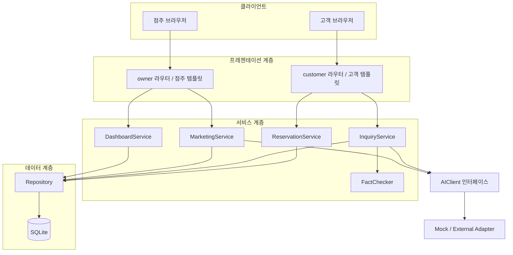

# 시스템 설계서

- 프로젝트: 소상공인용 AI 마케팅·고객응대 통합 지원 시스템
- 팀: 신창섭
- 작성자: 전지호(설계)
- 작성 기간: 2026. 11. 3. ~ 11. 8.
- 관련 기능: F-04 홍보 문구 생성, F-05 점주 대시보드

## 1. 설계 범위

이번 문서는 WBS에서 전지호에게 배정된 11주차 설계 산출물이다. 시스템 전체 구조를 정의하되, 담당 기능인 F-04와 F-05를 중심으로 상세 설계한다.

- F-04-1: 점주는 인스타그램·블로그·문자 채널, 홍보 대상, 키워드를 선택해 문구를 생성한다.
- F-04-2: 채널별 글자 수·해시태그 수·어조 규칙을 적용하고 위반 여부를 표시한다.
- F-04-3: 생성 문구를 수정·저장·복사하고 채널별 저장 목록을 조회한다.
- F-05-1: 오늘 예약 목록(상태별), 미응답 문의 수, 최근 생성 콘텐츠 5건을 표시한다.
- F-05-2: 대시보드 항목 선택 시 해당 처리 화면으로 이동한다.

이번 주에는 설계 문서만 작성한다. F-04 구현은 WBS상 12~13주차, F-05 구현은 13주차 업무이므로 코드 구현은 포함하지 않는다.

## 2. 아키텍처 스타일

### 2.1 선택한 구조: 3계층 아키텍처 + 클라이언트-서버 구조

1. **프레젠테이션 계층**: FastAPI 라우터와 Jinja2 템플릿으로 고객 화면과 점주 화면을 제공한다.
2. **서비스 계층**: 예약·문의·홍보 기능의 업무 규칙을 처리한다. 홍보 문구 생성은 `MarketingService`, 대시보드 데이터 구성은 `DashboardService`가 담당하도록 설계한다.
3. **데이터 계층**: SQLAlchemy 모델과 Repository가 SQLite 데이터의 조회·저장을 담당한다.

브라우저는 FastAPI 서버에 요청한다. 서버는 서비스 계층과 데이터 계층을 거쳐 결과를 반환한다. AI 호출이 필요한 기능은 서비스가 `AIClient` 인터페이스를 통해 Adapter에 요청한다.

### 2.2 선택 근거

- 업무 규칙을 화면과 분리하면 화면이 바뀌어도 서비스 로직을 재사용할 수 있다.
- 데이터 접근을 Repository로 분리하면 DB 조회 방식이 바뀌어도 화면과 업무 규칙의 수정 범위를 줄일 수 있다.
- 점주와 고객은 이용 목적이 다르므로 화면을 분리하되 서버와 DB는 공유한다.
- AI 제공사별 코드를 서비스에서 직접 호출하지 않고 Adapter 뒤에 두어 Mock과 외부 API를 교체할 수 있다.

### 2.3 대안 검토

화면 중심 MVC만으로 구성하면 라우터·컨트롤러에 예약 규칙, 채널별 규칙, DB 접근이 섞일 가능성이 있다. 본 프로젝트는 기능별 변경과 테스트를 쉽게 하기 위해 서비스 계층과 저장소 경계를 명확히 둔 3계층 구조를 선택한다.

## 3. 시스템 구성도

프레젠테이션 계층은 서비스 계층만 호출한다. 서비스는 라우터를 import하지 않으며 SQL을 직접 실행하지 않는다. AI 요청은 `app/adapters/ai`의 공통 인터페이스를 통해 전달한다. DashboardService와 세부 Repository 메서드는 설계 대상이며 현재 저장소에는 구현 전 골격만 존재한다.

## 4. 4+1 관점 설계

### 4.1 논리적 관점 (Logical View)

- 주요 도메인 객체: `Store`, `MenuItem`, `FAQ`, `Customer`, `Reservation`, `ReservationHistory`, `Inquiry`, `MarketingContent`.
- F-04는 `MarketingService`가 채널별 `ChannelStrategy`를 선택해 프롬프트와 규칙 검사를 수행한다.
- F-05는 `DashboardService`가 예약·문의·홍보 콘텐츠를 조회해 화면 표시용 결과로 구성한다.
- AI가 만든 결과는 자동 게시하지 않는다. 문구는 점주가 확인·수정한 뒤 저장·복사한다.

### 4.2 개발 관점 (Development View)

| 패키지 | 책임 | 관련 경로 |
|---|---|---|
| presentation | HTTP 요청·응답 및 화면 | `app/presentation/routers/owner.py`, `templates/owner/` |
| services/marketing | 채널 선택, 문구 생성, 규칙 검사 | `app/services/marketing/service.py`, `strategies.py` |
| services/dashboard | 대시보드 조회 결과 구성 | 설계 후 추가할 서비스 |
| repositories | 조회·저장 캡슐화 | `app/repositories/` |
| models | DB 엔티티 | `app/models/models.py` |
| adapters/ai | AI 공급자 교체 | `app/adapters/ai/` |

### 4.3 프로세스 관점 (Process View)

**F-04 문구 생성 흐름**

1. 점주가 채널, 홍보 대상, 키워드를 선택한다.
2. 라우터가 입력값을 검증하고 `MarketingService.generate()`를 호출한다.
3. 서비스가 채널 이름에 맞는 `ChannelStrategy`를 선택한다.
4. 전략이 채널 가이드와 입력값으로 프롬프트를 구성한다.
5. AIClient가 Adapter를 통해 문구 초안을 반환한다.
6. 전략의 `check()`가 글자 수와 해시태그 수를 검사한다.
7. 화면은 문구와 위반 목록을 표시한다. 점주는 직접 수정한 뒤 저장하거나 복사한다.

**F-05 대시보드 조회 흐름**

1. 점주가 `/owner`에 접속한다.
2. 라우터가 대시보드 조회 서비스를 호출한다.
3. 서비스는 오늘 예약 목록, 미응답 문의 수, 최근 콘텐츠 5건을 조회한다.
4. 조회 결과를 화면 표시용 데이터로 묶어 템플릿에 전달한다.
5. 항목 선택 시 예약·문의·홍보 콘텐츠 처리 화면으로 이동한다.

### 4.4 물리적 관점 (Physical View)

- 실행 환경: Python 3.11 이상, FastAPI 서버, SQLite DB.
- 사용자 단말: 일반 웹 브라우저(고객·점주).
- 템플릿 렌더링은 서버에서 수행한다.
- AI 외부 API는 서버에서 Adapter를 통해 호출한다. API 키는 환경 변수로 관리하며 저장소에 커밋하지 않는다.
- 수업 프로젝트 시연은 가상 데이터와 Mock AI를 우선 사용한다.

### 4.5 시나리오 관점 (+1)

| 시나리오 | 요구사항 | 주요 구성요소 | 기대 결과 |
|---|---|---|---|
| 인스타그램 홍보 문구 생성 | F-04-1, F-04-2 | owner 라우터, MarketingService, InstagramStrategy, AIClient | 초안과 규칙 검사 결과 표시 |
| 문구 저장 및 목록 확인 | F-04-3 | MarketingService, MarketingContent Repository | 수정 문구 저장 및 채널별 조회 |
| 오늘 업무 현황 확인 | F-05-1 | owner 라우터, DashboardService, Repository | 오늘 예약, 미응답 수, 최근 콘텐츠 5건 표시 |
| 대시보드에서 처리 화면 이동 | F-05-2 | 대시보드 템플릿, owner 라우터 | 해당 처리 화면으로 이동 |

## 5. 품질 속성 및 검증 계획

| ID | 품질 속성 | 목표 | 설계·달성 방법 | 검증 방법 |
|---|---|---|---|---|
| NF-01 | 사용성 | 미응답 문의 1건을 AI 초안 생성부터 발송 완료까지 1분 이내 처리 | 대시보드에서 처리 화면으로 바로 이동, 주요 동작을 한 화면에 배치 | 팀 외 사용자 3명에게 과업 5회 수행, 평균 처리 시간 측정 |
| NF-02 | 변경용이성 | 새 홍보 채널 추가 시 기존 클래스 수정 없이 전략 클래스 1개 추가 | ChannelStrategy 인터페이스와 등록 방식 사용 | 테스트용 채널 전략 추가 후 변경 파일 수 확인 |
| NF-03 | 변경용이성 | AI 제공사 교체 시 Adapter 클래스만 수정 | AIClient 인터페이스로 서비스와 제공사 분리 | Mock Adapter로 교체해 관련 테스트 실행 |
| NF-04 | 신뢰성 | AI API 장애 시 예약·문의 등록 등 핵심 기능 정상 동작 | AI 오류를 예외 처리하고 수동 입력 경로 제공 | AI 호출 실패를 강제로 발생시켜 예약·문의 등록 및 수동 답변 확인 |

## 6. F-04·F-05 설계 결정

### 6.1 홍보 채널 확장

현재 채널은 인스타그램, 블로그, 문자 3개로 제한한다. 채널별 차이는 글자 수, 해시태그 수, 어조 및 프롬프트 가이드로 분리한다. 새 채널은 전략 클래스를 추가하고 등록하는 방식으로 확장한다(NF-02).

### 6.2 대시보드 데이터 범위

대시보드는 요구사항에 명시된 데이터만 표시한다.

- 오늘 예약: 예약 일시가 오늘인 항목과 상태.
- 미응답 문의 수: 상태가 `미응답`인 문의의 개수.
- 최근 콘텐츠: 생성 시각 기준 최신 MarketingContent 5건.
- 바로가기: 예약 관리, 문의 처리, 홍보 문구 화면으로 이동.

추가 통계·차트·알림은 이번 MVP 범위에 포함하지 않는다.

## 7. 설계 제약 및 구현 시 확인사항

- 가격·영업시간 등 사실 판단은 AI에 맡기지 않고 DB 값과 코드로 확인한다.
- AI 문구는 초안이며 점주 확인 없이 외부 게시·발송하지 않는다.
- F-04 저장 시 점주가 수정한 최종 문구와 채널을 저장한다.
- 대시보드의 오늘 기준은 서버의 로컬 날짜 기준으로 일관되게 처리한다.
- 현재 코드의 일부 기능은 TODO 상태다. 구현 후 실제 클래스·라우트와 본 설계서를 대조해 갱신한다.
