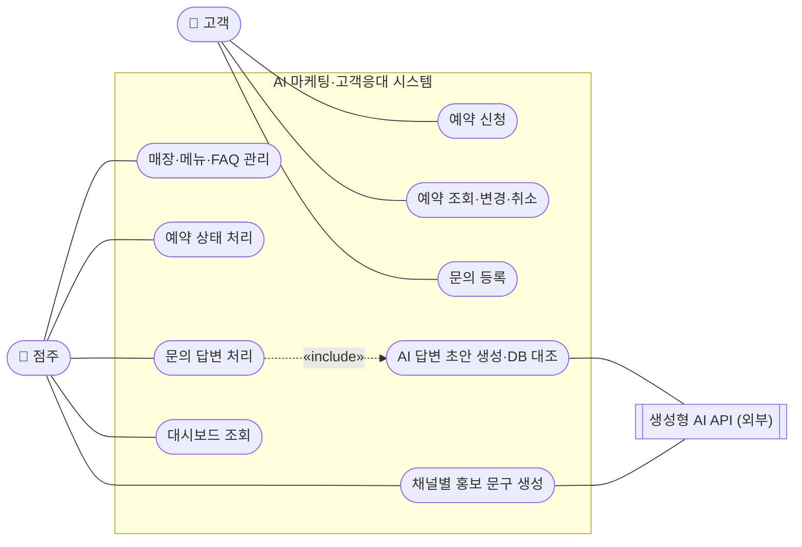
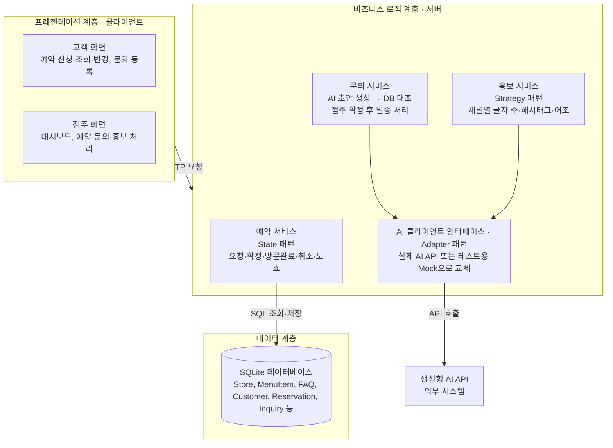
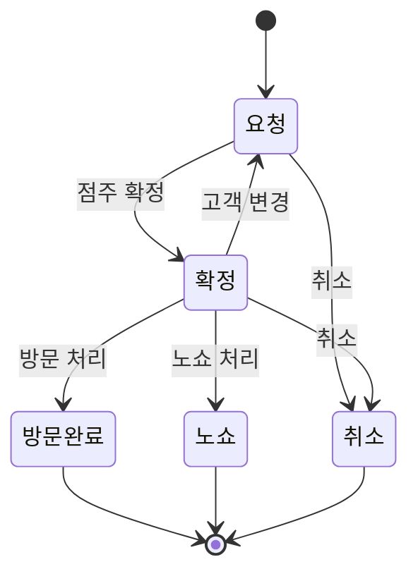

# 소상공인용 AI 마케팅·고객응대 통합 지원 시스템 — 기획서 및 요구사항 정의서

> 원본: Claude 문서 [기획서 및 요구사항 정의서](https://claude.ai/artifact/V2xe6GyYuFoP2MaS8sb3xY)
> (2026-10-27 기준, rev 23에서 가져옴). 원본이 바뀌면 이 파일도 갱신한다.
> 원본의 다이어그램 4개는 Mermaid·표로 옮겼다.

2026-10-27 · 정회성

## 1. 프로젝트 개요

소상공인 점주가 예약·문의·홍보 업무를 한 화면에서 처리하고, 생성형 AI로 답변과 홍보 문구 작성 부담을 줄이는 웹 시스템을 5주 안에 구현한다.

| 항목 | 내용 |
| --- | --- |
| 과제명 | 소상공인용 AI 마케팅·고객응대 통합 지원 시스템 (PBL 과제 1) |
| 과목 | 융합SW모델설계, 2026학년도 2학기 |
| 수행 기간 | 10주차(10/27) ~ 14주차(11/24), 15주차(12/1) 최종 발표 |
| 팀 구성 | 팀 신창섭 (3인): 한재형(PM), 정회성(개발·검증), 전지호(설계) |
| 시스템 형태 | 웹 애플리케이션, 점주 화면과 고객 화면 분리 |
| 기술 스택(안) | Python FastAPI + SQLite + 생성형 AI API (상세는 11절) [^stack] |

## 2. 배경 및 문제 정의

1인 또는 소규모 매장의 점주는 영업 중에 예약 관리, 고객 문의 응대, SNS 홍보를 동시에 처리해야 한다. 이 업무들이 메신저, 전화, 메모에 흩어져 있어 누락이 잦고 홍보는 뒤로 밀린다.

해결하려는 문제는 세 가지다.

- **예약 누락과 노쇼 관리 부재**: 예약이 여러 경로로 들어와 상태(확정, 취소, 노쇼)를 한눈에 볼 수 없다.
- **반복 문의 응대 부담**: 영업시간, 가격, 주차 같은 같은 질문에 매번 직접 답해야 한다.
- **홍보 문구 작성 부담**: 채널마다 글자 수와 어조가 달라 문구를 따로 써야 하고, 결국 홍보를 미루게 된다.

이 시스템은 세 업무를 하나의 점주 화면으로 모으고, 반복적인 글쓰기를 AI 초안으로 대체하되 최종 확정은 점주가 하도록 한다.

## 3. 목표 및 범위

목표는 필수 기능 F-01~F-05를 14주차까지 완성하고, AI 결과를 DB 정보와 자동 대조하는 검증 장치를 갖추는 것이다.

| 구분 | 내용 |
| --- | --- |
| 포함 | 매장·메뉴 관리, 예약 상태 관리, 문의 접수와 AI 답변 초안, 채널별 AI 홍보 문구, 점주 대시보드 |
| 포함(검증) | AI 답변·문구 속 가격·영업시간의 DB 대조 경고, 채널 규칙(글자 수, 해시태그) 자동 검사 |
| 선택(여유 시) | 예약 알림 메시지 자동 생성, 리뷰 답글 초안, 월간 홍보 캘린더 중 1개 |
| 제외 | 실제 SNS 게시·문자 발송 API 연동("복사하기"로 대체), 결제, 실제 개인정보 사용 |

부교재 실습과 차별화하기 위해 AI 문구 생성보다 **예약 상태 전이와 문의 응대 흐름(접수 → AI 초안 → 점주 확인 → 발송 완료)** 설계에 비중을 둔다.

## 4. 사용자 및 이해관계자

주 사용자는 점주이며, 고객은 예약과 문의를 넣는 보조 사용자다.

| 사용자 | 특징 | 주요 목적 | 사용 화면 |
| --- | --- | --- | --- |
| 매장 점주(관리자) | 영업 중 짧은 틈에 업무 처리, IT 숙련도 보통 | 예약 확정, 문의 답변, 홍보 문구 확보 | 점주용 화면(대시보드 중심) |
| 매장 고객 | 모바일로 접속, 회원가입 없이 이용 희망 | 예약 신청·변경·취소, 문의 등록 | 고객용 화면 |
| 외부 시스템: 생성형 AI API | 응답 지연·오류 가능 | 답변 초안과 홍보 문구 생성 | Adapter로 연결 |

## 5. 팀 구성 및 역할 분담

기능 단위로 나눠 각 팀원이 담당 기능의 설계·구현·테스트와 디자인 패턴 1개를 책임진다.

| 팀원 | 역할 | 담당 기능 | 디자인 패턴 | 담당 문서·업무 |
| --- | --- | --- | --- | --- |
| 한재형 | PM | F-01 매장·메뉴 관리, F-02 예약 관리 | State | 기획서, 요구사항 정의서, 유스케이스, 일정·회의 관리, 최종 발표 총괄 |
| 정회성 | 개발·검증 | F-03 문의 접수·AI 답변 초안 | Adapter | 코딩 규칙·CLAUDE.md, 개발 환경·GitHub 관리, 테스트 케이스, AI 활용 로그, AI 검증 보고서 |
| 전지호 | 설계 | F-04 채널별 AI 홍보 문구, F-05 대시보드 | Strategy | 아키텍처 설계(4+1 관점), 클래스 다이어그램·SOLID 점검, ERD |

세 사람 모두 담당 기능의 구현에 참여하고, 역할별 문서와 업무를 추가로 책임진다. 가상 데이터 생성은 각자 담당 기능 분량을 맡는다.

## 6. 기능 요구사항

필수 기능 5개를 세부 요구사항 18개로 나눴다. 우선순위 "상"은 MVP 필수, "중"은 MVP에 포함하되 단순하게 구현해도 되는 항목이다. 확장 기능은 3절의 선택 범위를 따른다.

| ID | 요구사항 | 우선순위 | 담당 |
| --- | --- | --- | --- |
| F-01-1 | 점주는 매장 기본 정보(매장명, 영업시간, 위치, 휴무일, 연락처)를 등록·수정할 수 있다 | 상 | 한재형 |
| F-01-2 | 점주는 메뉴·상품(이름, 가격, 설명, 판매 여부)을 등록·수정·삭제할 수 있다 | 상 | 한재형 |
| F-01-3 | 점주는 FAQ(질문, 답변)를 등록·수정·삭제할 수 있다 | 상 | 한재형 |
| F-02-1 | 고객은 날짜·시간·인원을 입력해 예약을 신청할 수 있으며, 상태는 "요청"으로 생성된다 | 상 | 한재형 |
| F-02-2 | 시스템은 휴무일·영업시간 외 시간과 정원을 초과하는 예약 신청을 거부한다 | 상 | 한재형 |
| F-02-3 | 고객은 연락처로 본인 예약을 조회하고, "요청"·"확정" 상태에서만 변경·취소할 수 있다 | 상 | 한재형 |
| F-02-4 | 점주는 예약을 확정, 방문완료, 노쇼, 취소로 처리하며 상태별로 허용되지 않은 전이는 거부된다 | 상 | 한재형 |
| F-02-5 | 시스템은 모든 상태 변경 이력(변경 시각, 이전·이후 상태)을 기록한다 | 중 | 한재형 |
| F-03-1 | 고객은 이름·연락처와 함께 문의를 등록할 수 있으며, 상태는 "미응답"으로 생성된다 | 상 | 정회성 |
| F-03-2 | 점주가 요청하면 AI가 매장 정보·메뉴·FAQ를 근거로 답변 초안을 생성한다 | 상 | 정회성 |
| F-03-3 | 시스템은 초안 속 가격·영업시간을 DB와 대조해 불일치 시 경고를 표시한다 | 상 | 정회성 |
| F-03-4 | 점주는 초안을 수정한 뒤 "발송 완료"로 확정하고 답변을 복사할 수 있다 | 상 | 정회성 |
| F-03-5 | AI API 호출이 실패하면 오류 안내를 표시하고 점주가 직접 답변을 작성할 수 있다 | 중 | 정회성 |
| F-04-1 | 점주는 채널(인스타그램, 블로그, 문자)과 홍보 대상(메뉴, 이벤트), 키워드를 선택해 문구를 생성할 수 있다 | 상 | 전지호 |
| F-04-2 | 시스템은 채널별 규칙(글자 수, 해시태그 수, 어조)에 맞춰 문구를 생성하고 규칙 위반 여부를 표시한다 | 상 | 전지호 |
| F-04-3 | 점주는 생성된 문구를 수정·저장·복사하고, 저장 목록을 채널별로 조회할 수 있다 | 상 | 전지호 |
| F-05-1 | 대시보드는 오늘 예약 목록(상태별), 미응답 문의 수, 최근 생성 콘텐츠 5건을 보여준다 | 상 | 전지호 |
| F-05-2 | 대시보드의 각 항목을 누르면 해당 처리 화면으로 바로 이동한다 | 중 | 전지호 |

## 7. 비기능 요구사항

핵심 품질 속성은 사용성과 변경용이성이며, 각각 측정 가능한 목표와 검증 방법을 둔다.

| ID | 품질 속성 | 목표 | 달성 방법 | 검증 방법 |
| --- | --- | --- | --- | --- |
| NF-01 | 사용성 | 점주가 미응답 문의 1건을 AI 초안 생성부터 발송 완료까지 1분 이내에 처리 | 대시보드에서 1번 클릭으로 문의 화면 진입, 초안 생성 버튼과 복사 버튼을 한 화면에 배치 | 팀원 외 사용자 3명에게 과업 5회 수행시켜 평균 처리 시간 측정 |
| NF-02 | 변경용이성 | 새 홍보 채널(예: 카카오톡 채널) 추가 시 기존 클래스 수정 없이 클래스 1개 추가로 완료 | 채널별 생성 규칙을 Strategy 인터페이스로 분리, 채널 목록은 등록 방식으로 관리 | 실제로 채널 1개를 추가해 보고 변경된 파일 수를 기록 |
| NF-03 | 변경용이성 | AI 제공사 교체 시 Adapter 클래스 1개만 수정 | AI 호출을 공통 인터페이스 뒤로 숨김 | Mock AI Adapter로 교체해 전체 기능이 동작하는지 테스트 |
| NF-04 | 신뢰성 | AI API 장애 시에도 예약·문의 등록 등 핵심 기능은 정상 동작 | AI 호출 실패를 예외 처리하고 수동 입력 경로 제공 | AI 호출 실패를 강제로 발생시키는 예외 테스트 케이스 |

## 8. 유스케이스

고객은 예약과 문의만 하고, 나머지 업무는 모두 점주가 처리한다. AI 호출은 문의 답변과 홍보 문구 두 곳으로 한정한다.

**그림: 유스케이스 다이어그램 · 행위자 3, 유스케이스 9**



문의 답변 처리는 AI 초안 생성과 DB 대조를 항상 포함(include)하며, 점주가 확인하기 전에는 발송되지 않는다.

| ID | 유스케이스 | 행위자 | 관련 기능 |
| --- | --- | --- | --- |
| UC-01 | 예약 신청 | 고객 | F-02-1, F-02-2 |
| UC-02 | 예약 조회·변경·취소 | 고객 | F-02-3 |
| UC-03 | 문의 등록 | 고객 | F-03-1 |
| UC-04 | 매장·메뉴·FAQ 관리 | 점주 | F-01-1 ~ F-01-3 |
| UC-05 | 문의 답변 처리 (AI 초안 생성·DB 대조 포함) | 점주, AI API | F-03-2 ~ F-03-5 |
| UC-06 | 예약 상태 처리 | 점주 | F-02-4, F-02-5 |
| UC-07 | 채널별 홍보 문구 생성 | 점주, AI API | F-04-1 ~ F-04-3 |
| UC-08 | 대시보드 조회 | 점주 | F-05-1, F-05-2 |

점주 화면은 간단한 로그인(점주 계정 1개)을 거친 뒤 이용하며, 고객 화면은 로그인 없이 이름과 연락처로 본인을 확인한다.

### UC-01 예약 신청

- **행위자**: 고객
- **사전 조건**: 매장 정보와 영업시간이 등록되어 있다.
- **기본 흐름**:
  1. 고객이 고객 화면에서 날짜를 선택한다.
  2. 시스템이 그 날짜의 예약 가능 시간대를 보여준다.
  3. 고객이 시간, 인원, 이름, 연락처, 요청사항을 입력하고 신청한다.
  4. 시스템이 휴무일, 영업시간, 시간당 정원을 검사한다.
  5. 시스템이 상태 "요청"으로 예약을 저장하고 예약 번호를 보여준다.
- **예외 흐름**:
  - 휴무일이거나 영업시간 밖이면 신청을 거부하고 사유를 표시한다.
  - 정원을 초과하면 거부하고 예약 가능한 다른 시간대를 보여준다.
  - 과거 날짜, 필수 입력 누락, 연락처 형식 오류는 해당 입력란에 오류를 표시한다.
- **사후 조건**: "요청" 상태의 예약과 상태 이력이 저장되고, 점주 대시보드에 반영된다.

### UC-02 예약 조회·변경·취소

- **행위자**: 고객
- **사전 조건**: 고객이 예약을 1건 이상 신청했다.
- **기본 흐름**:
  1. 고객이 이름과 연락처를 입력한다.
  2. 시스템이 일치하는 예약 목록과 상태를 보여준다.
  3. 고객이 예약을 선택하고 변경 또는 취소를 누른다.
  4. 변경이면 새 일시·인원을 입력하고, 시스템이 UC-01과 같은 검사를 한 뒤 상태를 "요청"으로 되돌린다.
  5. 취소이면 확인 창을 거쳐 상태를 "취소"로 바꾼다.
- **예외 흐름**:
  - 일치하는 예약이 없으면 "예약을 찾을 수 없습니다"를 표시한다.
  - 방문완료·노쇼·취소 상태에서는 변경·취소 버튼을 보이지 않고, 직접 요청해도 거부한다.
  - 변경한 시간이 정원을 초과하면 거부하고 기존 예약을 그대로 유지한다.
- **사후 조건**: 예약 상태와 상태 이력이 갱신된다.

### UC-03 문의 등록

- **행위자**: 고객
- **사전 조건**: 없음
- **기본 흐름**:
  1. 고객이 문의 화면에서 이름, 연락처, 문의 내용을 입력한다.
  2. 시스템이 상태 "미응답"으로 문의를 저장한다.
  3. 시스템이 접수 완료 안내를 보여준다.
- **예외 흐름**: 내용이 비어 있거나 1,000자를 넘으면 등록을 거부하고 사유를 표시한다.
- **사후 조건**: 미응답 문의가 생성되고 대시보드의 미응답 문의 수가 늘어난다.

### UC-04 매장·메뉴·FAQ 관리

- **행위자**: 점주
- **사전 조건**: 점주가 로그인했다.
- **기본 흐름**:
  1. 점주가 관리 화면에서 매장 정보, 메뉴, FAQ 중 하나를 고른다.
  2. 점주가 항목을 등록, 수정 또는 삭제한다.
  3. 시스템이 입력값을 검사한 뒤 저장한다.
- **예외 흐름**:
  - 가격이 음수이거나 숫자가 아니면 거부한다.
  - 영업 종료 시각이 시작 시각보다 이르면 거부한다.
  - 이미 예약이 있는 날을 휴무일로 지정하면 경고와 함께 해당 예약 목록을 보여준다.
- **사후 조건**: 바뀐 정보가 이후 AI 프롬프트와 DB 대조 기준에 바로 반영된다.

### UC-05 문의 답변 처리

- **사전 조건**: 점주가 로그인했고, 상태가 "미응답"인 문의가 1건 이상 있다.
- **기본 흐름**:
  1. 점주가 대시보드에서 미응답 문의를 선택한다.
  2. 점주가 "AI 초안 생성"을 누른다.
  3. 시스템이 매장 정보·메뉴·FAQ를 프롬프트에 넣어 AI API를 호출한다.
  4. 시스템이 초안 속 가격·영업시간을 DB와 대조하고 결과를 표시한다.
  5. 점주가 초안을 확인·수정하고 "발송 완료"를 누른다.
  6. 시스템이 문의 상태를 "답변 완료"로 바꾸고 답변을 저장한다.
- **예외 흐름**:
  - 3단계에서 AI 호출이 실패하면 오류 안내와 함께 빈 답변 입력란을 제공한다.
  - 4단계에서 불일치가 발견되면 해당 문장을 강조하고 경고를 띄운다. 점주가 수정하거나 무시를 선택해야 발송할 수 있다.
- **사후 조건**: 문의 상태가 "답변 완료"이고, 최종 답변과 AI 원본 초안이 함께 저장된다(검증 보고서용).

### UC-06 예약 상태 처리

- **사전 조건**: 상태가 "요청" 또는 "확정"인 예약이 있다.
- **기본 흐름**: 점주가 예약을 선택하고 허용된 동작(확정, 방문완료, 노쇼, 취소) 중 하나를 누르면 상태가 바뀌고 이력이 기록된다.
- **예외 흐름**: 허용되지 않은 전이(예: "취소" 상태에서 "확정")를 요청하면 거부하고 사유를 표시한다. 화면에는 현재 상태에서 가능한 버튼만 보인다.
- **사후 조건**: 예약 상태와 상태 변경 이력이 갱신된다.

### UC-07 채널별 홍보 문구 생성

- **행위자**: 점주, 생성형 AI API
- **사전 조건**: 점주가 로그인했고, 메뉴가 1개 이상 등록되어 있다.
- **기본 흐름**:
  1. 점주가 채널(인스타그램, 블로그, 문자)을 고른다.
  2. 점주가 홍보 대상(메뉴 또는 이벤트)과 키워드를 입력하고 생성을 누른다.
  3. 시스템이 채널 전략에 맞게 프롬프트를 만들어 AI API를 호출한다.
  4. 시스템이 채널 규칙(글자 수, 해시태그 수) 검사와 메뉴명·가격 DB 대조 결과를 함께 보여준다.
  5. 점주가 문구를 수정한 뒤 저장하거나 복사한다.
- **예외 흐름**:
  - AI 호출이 실패하면 오류를 안내하고 다시 시도하거나 직접 작성할 수 있게 한다.
  - 규칙을 어기면 위반 항목을 표시하고 다시 생성할 수 있게 한다.
  - 가격·메뉴명이 DB와 다르면 해당 부분을 강조하고 경고한다.
- **사후 조건**: 채널, 문구, 규칙 검사 결과가 함께 저장된다.

### UC-08 대시보드 조회

- **행위자**: 점주
- **사전 조건**: 점주가 로그인했다.
- **기본 흐름**:
  1. 점주가 로그인하면 대시보드가 첫 화면으로 열린다.
  2. 시스템이 오늘 예약(상태별 개수와 목록), 미응답 문의 수, 최근 생성 콘텐츠 5건을 보여준다.
  3. 점주가 항목을 누르면 해당 처리 화면(UC-05, UC-06, UC-07)으로 이동한다.
- **예외 흐름**: 표시할 데이터가 없으면 "오늘 예약이 없습니다"처럼 빈 상태 안내를 보여준다.
- **사후 조건**: 없음(조회 전용)

## 9. 주요 데이터 및 개념 모델

엔티티 8개로 시작하며, 안내서의 7개에 예약 상태 이력(ReservationHistory)을 추가했다. 모든 데이터는 생성형 AI로 만든 가상 데이터다.

| 엔티티 | 주요 속성 | 관계 | 가상 데이터 수량 |
| --- | --- | --- | --- |
| Store | 매장명, 업종, 주소, 영업시간, 휴무일, 연락처, 시간당 정원 | MenuItem·FAQ·Reservation·Inquiry·MarketingContent를 가짐 (1:N) | 2개 (카페 1, 미용실 1) |
| MenuItem | 이름, 가격, 설명, 판매 여부 | Store에 속함 | 매장당 10~15개 |
| FAQ | 질문, 답변 | Store에 속함 | 매장당 10개 |
| Customer | 이름, 연락처 | Reservation·Inquiry를 가짐 (1:N) | 30명 |
| Reservation | 일시, 인원, 요청사항, 상태(요청/확정/방문완료/취소/노쇼) | Store·Customer에 속함 | 50건 (상태별 분포) |
| ReservationHistory | 이전 상태, 이후 상태, 변경 시각 | Reservation에 속함 | 예약 처리 시 자동 생성 |
| Inquiry | 내용, 접수 시각, 상태(미응답/답변완료), AI 원본 초안, 최종 답변, 대조 결과 | Store·Customer에 속함 | 30건 (검증용) |
| MarketingContent | 채널, 홍보 대상, 키워드, 생성 문구, 규칙 검사 결과, 저장 시각 | Store에 속함 | 채널별 5건 이상 |

Inquiry에 AI 원본 초안과 최종 답변을 따로 저장하는 이유는 점주가 얼마나 수정했는지를 검증 보고서에서 측정하기 위해서다. 상세 ERD는 11주차 설계서에서 작성한다.

## 10. 아키텍처 및 디자인 패턴 적용 계획

3계층(프레젠테이션–비즈니스 로직–데이터) 구조에 점주·고객 화면을 분리한 클라이언트-서버 구조를 결합한다. 디자인 패턴은 State, Strategy, Adapter 3개를 적용한다(3인 팀 기준 2개 이상 충족).

**그림: 시스템 아키텍처 · 3계층 + 클라이언트-서버**



> 점주·고객 화면을 분리하고 AI 호출은 Adapter 뒤에 숨긴 3계층 구조

화면은 서비스 계층만 호출하고, 서비스는 AI를 항상 Adapter 인터페이스를 통해서만 부른다.

### 아키텍처 선택 근거

- **3계층 구조**: 예약 규칙·AI 대조 같은 비즈니스 로직을 화면과 DB에서 분리해, 화면이 바뀌거나 DB를 교체해도 로직은 그대로 두기 위해서다. 팀원 3명이 계층별이 아닌 기능별로 나눠 작업해도 구조가 일관된다.
- **클라이언트-서버 분리**: 점주와 고객은 필요한 기능과 권한이 다르므로 화면을 나누고, 하나의 서버 API를 공유한다.
- **대안 검토**: MVC는 웹 화면 단위 구조에는 적합하지만 AI 호출·대조 같은 로직이 컨트롤러에 쌓일 위험이 있어, 서비스 계층을 두는 3계층을 선택했다.

### 디자인 패턴 적용 근거

| 패턴 | 적용 지점 | 무엇이 자주 바뀌는가 | 담당 |
| --- | --- | --- | --- |
| State | 예약 상태 5개를 상태 클래스로 분리, 상태별 허용 동작 정의 | 예약 정책(취소 가능 시점, 새 상태 추가 등)이 바뀌어도 if문을 고치지 않고 해당 상태 클래스만 수정 | 한재형 |
| Strategy | 채널별 문구 생성 규칙(글자 수, 해시태그, 어조)을 전략 클래스로 분리 | 홍보 채널이 추가되거나 채널 규칙이 바뀌는 것(NF-02) | 전지호 |
| Adapter | 외부 생성형 AI API를 공통 인터페이스로 감싸 교체 가능하게 구성 | AI 제공사·모델 변경, 테스트용 Mock 전환(NF-03) | 정회성 |

### 4+1 관점 작성 계획

| 관점 | 산출물 | 담기는 내용 |
| --- | --- | --- |
| 시나리오(유스케이스) | 8절 유스케이스 다이어그램 | 행위자와 핵심 시나리오 |
| 논리 관점 | 클래스 다이어그램 | 엔티티·서비스·패턴 클래스와 관계 유형 |
| 개발 관점 | 패키지 다이어그램 | 계층별 패키지와 의존 방향 |
| 물리 관점 | 배포 다이어그램 | 브라우저, 웹 서버, SQLite, 외부 AI API |

### 예약 상태 전이 (State 패턴)

**그림: 예약 상태 전이도 · 상태 5개**



> 확정된 예약만 방문완료·노쇼로 끝나고, 종료 상태(방문완료·노쇼·취소)에서는 모든 동작이 거부된다.

각 상태 클래스는 확정, 방문처리, 노쇼처리, 취소, 변경 동작을 구현하고, 허용되지 않는 동작은 예외를 던진다. 확정된 예약을 고객이 변경하면 "요청"으로 돌아가 점주가 다시 확정해야 한다.

## 11. 기술 스택

백엔드는 Python FastAPI, DB는 SQLite, 화면은 서버 렌더링(Jinja2)으로 구성한다. 5주 안에 3명이 익히고 완성할 수 있는 가벼운 조합을 우선했다.

| 구분 | 선택 | 선택 이유 |
| --- | --- | --- |
| 언어 | Python 3.11 이상 | 팀원 모두 사용 가능, AI API SDK와 데이터 생성 스크립트 작성이 쉬움 |
| 백엔드 프레임워크 | FastAPI | 라우터 단위로 기능을 나누기 쉽고, 자동 생성되는 API 문서(Swagger)로 팀원 간 연동 확인이 빠름 |
| 화면 | Jinja2 템플릿 + Bootstrap | 별도 프론트엔드 빌드 없이 점주·고객 화면을 분리 구현, 모바일 대응 기본 제공 |
| DB | SQLite | 공통 요건에서 허용, 설치 없이 파일 하나로 팀원 간 공유 |
| ORM | SQLAlchemy | Repository 계층을 두어 비즈니스 로직과 SQL을 분리, 추후 DB 교체 용이 |
| 생성형 AI | 상용 생성형 AI API 1종 (팀이 키를 발급받을 수 있는 것) | Adapter 뒤에 두므로 어떤 API든 교체 가능, 개발 중에는 Mock Adapter 사용 |
| 설정 관리 | python-dotenv (.env) | API 키를 코드와 분리, .env는 Git에 올리지 않음 |
| 테스트 | pytest + FastAPI TestClient | 기능별 정상·예외 테스트 케이스와 State 전이 규칙을 자동 검증 |
| 코드 스타일 | Ruff (린트·포맷) | 팀 코딩 규칙을 도구로 강제, CLAUDE.md에 명시 |
| 형상 관리 | Git + GitHub (main, develop, feature 브랜치) | Pull Request 리뷰 후 develop에 병합 |
| 협업 | GitHub Issues + Projects 칸반 | 주차별 작업과 담당자를 한곳에서 관리 |
| AI 개발 도구 | Claude Code + CLAUDE.md | 과목 요건(코딩 규칙의 CLAUDE.md 반영)을 충족하고, 사용 내역을 AI 활용 로그에 기록 |
| 실행·시연 | 로컬 실행 (uvicorn) | 배포 없이 시연용 노트북에서 실행 |

### 프로젝트 폴더 구조(안)

아키텍처의 3계층과 디자인 패턴이 폴더에서 바로 드러나도록 나눈다.

```text
app/
  presentation/          # 프레젠테이션 계층
    routers/             #   owner.py, customer.py
    templates/owner/     #   점주 화면
    templates/customer/  #   고객 화면
  services/              # 비즈니스 로직 계층
    reservation/         #   ReservationService, 상태 클래스(State)
    inquiry/             #   InquiryService, FactChecker(DB 대조)
    marketing/           #   MarketingService, 채널 전략(Strategy)
  adapters/ai/           # AIClient 인터페이스, 실제 API Adapter, MockAdapter
  repositories/          # 데이터 계층 접근 (SQLAlchemy)
  models/                # Store, MenuItem, FAQ, Customer, Reservation ...
  db/                    # SQLite 파일, 초기화·가상 데이터 적재 스크립트
tests/                   # 기능별 정상·예외 테스트
CLAUDE.md                # 팀 코딩 규칙
.env.example             # API 키 설정 예시
```

팀원 중 React 경험자가 있으면 화면만 React로 바꾸고 FastAPI는 API 서버로 쓰는 구성도 가능하다. 이 경우 클라이언트-서버 분리가 더 분명해지지만 학습 부담이 늘어난다.

## 12. AI 활용 및 검증 계획

AI는 초안만 만들고 확정은 항상 점주가 한다. 검증은 사람이 판단할 필요가 없는 자동 대조와 사람이 확인하는 표본 평가를 함께 쓴다.

| 대상 | 검증 장치 | 측정 지표 | 표본 |
| --- | --- | --- | --- |
| F-03 문의 답변 초안 | 초안 속 가격·영업시간·휴무일을 정규식으로 추출해 DB 값과 자동 대조, 불일치 시 경고 | 사실 불일치율 (불일치 초안 수 ÷ 전체 초안 수) | 가상 문의 30건 |
| F-03 문의 답변 초안 | 팀원이 초안을 "그대로 사용 / 일부 수정 / 사용 불가"로 판정 | 그대로 사용 비율, AI 원본과 최종 답변의 수정 정도 | 가상 문의 30건 |
| F-03 대조 장치 자체 | 일부러 틀린 가격을 넣은 초안으로 경고가 뜨는지 테스트 | 오류 탐지율 | 오류 삽입 초안 10건 |
| F-04 홍보 문구 | 채널별 규칙(글자 수 범위, 해시태그 개수)을 코드로 자동 검사 | 규칙 준수율 | 채널 3개 × 10건 |
| F-04 홍보 문구 | 문구 속 메뉴명·가격이 DB와 일치하는지 대조 | 사실 불일치율 | 위와 동일 |

**AI 활용 로그**: 개발 과정에서 생성형 AI(코드 작성, 가상 데이터 생성, 문서 초안)를 쓴 내역은 날짜, 사용 목적, 프롬프트 요약, 결과 채택 여부를 팀 공용 표에 기록한다.

**프롬프트 원칙**: 매장 정보·메뉴·FAQ만 근거로 답하게 하고, 근거에 없는 내용은 "매장에 직접 문의해 주세요"로 답하도록 지시한다.

## 13. 일정 계획

5주 중 앞 2주는 기획·설계, 뒤 3주는 구현·검증에 쓴다. 12주차 말 중간 점검에서 F-01·F-02가 동작하지 않으면 일정을 조정한다.

**그림: 주차별 일정 · 10~14주차, 중간 점검 1회**

| 주차 | 기간 | 작업 |
| --- | --- | --- |
| 10주차 | 10/27 ~ 11/2 | 기획서, 요구사항 정의서, 유스케이스, 기술 스택 확정 |
| 11주차 | 11/3 ~ 11/9 | 아키텍처 설계, 클래스 설계·ERD, 코딩 규칙·CLAUDE.md, 가상 데이터 생성 |
| 12주차 | 11/10 ~ 11/16 | F-01·F-02 완성, F-03·F-04 AI 연동, Mock AI Adapter |
| ◆ 중간 점검 | 12주차 말 | **F-01·F-02 동작 완료** |
| 13주차 | 11/17 ~ 11/23 | F-03~F-05 완성, AI 검증 장치 구현, 테스트 케이스 작성 |
| 14주차 | 11/24 ~ 11/30 | 통합 테스트, AI 검증 보고서, 발표 자료, 확장 기능(선택) |
| ◆ 최종 발표 | 15주차 12/1 | |

> 12주차 말까지 F-01·F-02를 끝내야 나머지 기능이 밀리지 않는다.

예약 기능이 Store·Customer 데이터를 만들기 때문에, 문의·홍보·대시보드는 그 뒤에 완성된다. 팀 회의는 매주 1회 이상 열고 진행 상황을 이 문서에 반영한다.

## 14. 위험 요소 및 대응

가장 큰 위험은 부교재 실습과 결과물이 비슷해 보이는 것과, F-02가 늦어져 다른 기능이 밀리는 것이다.

| 위험 | 영향 | 대응 |
| --- | --- | --- |
| 부교재 실습 결과물과 유사해 보임 | 설계 평가에서 차별성 부족 | 예약 State 설계와 문의 응대 흐름을 설계서·발표의 중심에 두고, DB 대조 검증을 강조 |
| F-02(예약) 완성 지연 | Customer·Store 데이터에 의존하는 F-03~F-05 지연 | 12주차 중간 점검 시 F-02 완료를 필수 기준으로 두고, 지연 시 전지호가 지원 |
| AI API 비용·호출 제한·장애 | 개발·시연 중단 | Mock AI Adapter로 개발하고 실제 API는 시연·검증 때만 사용, 응답 캐싱 |
| 가상 데이터 준비 지연 | 시연과 검증 불가 | 11주차에 생성 프롬프트를 확정하고 각자 담당 엔티티 데이터를 생성 |
| 팀원 간 코드 스타일·구조 불일치 | 통합 시 충돌, 유지보수 어려움 | 11주차에 코딩 규칙과 CLAUDE.md를 먼저 확정, 브랜치 규칙과 코드 리뷰 운영 |

[^stack]: 원본 문서 댓글(정회성): "기술 스택을 FastAPI + SQLite로 가정했어요. 팀이 더 익숙한 스택(예: Spring, Node.js)이 있으면 여기 답글이나 문서 어디에든 댓글로 알려주세요."
